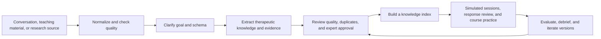

# TheraSkillAgent

TheraSkillAgent is a local agent workbench for **psychotherapy and counseling training, research, and therapeutic knowledge engineering**.

It connects therapeutic knowledge, dialogue processing, simulated patients, counseling-skill practice, expert review, and course evaluation in one reusable workflow. Researchers can organize and extract knowledge from authorized conversations or other sources. Instructors can create courses and simulated patients. Learners can practice sessions and receive structured feedback. Developers can extend the system through skills, knowledge indexes, and configurable model providers.

TheraSkillAgent is more than a chat interface that generates replies. It models the **process, evidence, interaction, and reflection** involved in psychotherapy training: an agent can ask for clarification, call tools, wait for approval, preserve checkpoints, and record the knowledge release, skill version, model configuration, and evaluation evidence used by a task.

The interface starts with the **Assistant**. A user can describe a question, a dialogue file, or a teaching goal in natural language. The Assistant can answer directly, retrieve knowledge, call a Skill, or move the work into a durable workspace task when more control is needed. Courses, knowledge, and simulation pages remain available for detailed follow-up.

[中文 README](README.zh.md) · [English step-by-step user guide](docs/user_guide.en.md) · [图文中文指南](docs/user_guide.zh.md) · [Offline installation](docs/deployment_offline.en.md) · [Deployment guide](docs/deployment.en.md) · [Simulated patients](docs/simulated_patients.en.md) · [Course Agent design](docs/course_agent_design.en.md) · [Resource installation](docs/resource_installation.en.md)

## What it is for

Psychotherapy training usually involves four connected activities:

1. **Understand conversations**: turn speech transcripts and inconsistent files into analyzable turns, speaker roles, and evidence spans.
2. **Organize therapeutic knowledge**: extract intervention principles, process rules, therapist skills, and case evidence from authorized conversations, teaching materials, research sources, or structured data, then make them searchable.
3. **Practice and review**: use editable simulated patients to practice empathy, open questions, cognitive reframing, risk awareness, and other skills, then evaluate the process and the response.
4. **Improve courses over time**: version scenarios, knowledge, skills, evaluation cases, and instructor feedback so that training material can be reviewed and refined.

The project puts these activities in one agent runtime, reducing manual handoffs between data work, training applications, and evaluation.

## Core workflow



Every step can be started from the browser workbench, CLI, or a skill. When a task needs a schema decision, sample approval, candidate review, or conflict resolution, it pauses with a checkpoint and can resume later.

## Main capabilities

| Workspace | Input | Output |
| --- | --- | --- |
| **Transcript analysis** | TXT, Markdown, JSON, CSV, SRT, VTT, or pasted text | Normalized turns, speaker mapping, risk cues, quality reviews, and traceable analysis bundles |
| **Knowledge extraction** | Conversation files, directories, JSONL, or registered source adapters | Extraction goals, editable schemas, sample results, evidence references, candidate packages, and governance tasks |
| **Knowledge and indexes** | Approved JSONL knowledge | Lexical or hybrid indexes, manifests, retrieval results, activation, and rollback records |
| **Simulated patients** | Training topic, patient dossier, recent events, and learning goals | Versioned patients, gradual-disclosure rules, reusable scenarios, and practice sessions |
| **Skills and tasks** | A natural-language goal, skills, tools, and a knowledge scope | Durable tasks with clarification, tool traces, approvals, checkpoints, retry, and recovery |
| **Expert review** | Therapist responses, conversations, knowledge candidates, or skill drafts | Structured evaluations, evidence citations, quality findings, duplicate checks, and release gates |
| **Courses and evaluation** | Course goals, scenario sets, learner attempts, and instructor feedback | Batch scenarios, practice records, debriefs, behavioral evaluations, regression cases, and learning progress |

## From course preparation to practice

In **Courses and learning progress**, start by discussing the teaching goal with the Course Agent, then adapt a bilingual teaching template, its objectives and knowledge cards, and assign approved simulated cases. Learners practise short responses before full sessions, save their reflections, and receive feedback tied to their own dialogue. See the [Course Agent design](docs/course_agent_design.en.md) for the interaction and confirmation flow.

The configured LLM judges one objective at a time using the course rubric and relevant retrieved knowledge. Source quotes are checked, unobserved behaviours remain unscored, and instructors record their decisions separately. Progress keeps track of support conditions, case difficulty and rubric versions. See the [teaching and learning guide](docs/learning.en.md).

## Why an agent and skills are useful here

Psychotherapy training is not a one-shot text-generation problem:

- Risk review, response review, and simulated-patient generation require different knowledge scopes.
- Conversation analysis often needs a speaker mapping, language choice, correction policy, and output schema before it can run.
- Knowledge extraction needs sampling, human confirmation, and governance before a result becomes a release.
- Simulated patients need a background, recent events, hidden concerns, disclosure levels, and an immutable case revision.
- Evaluation needs the original input, tool calls, citations, provider settings, and scoring evidence for later review.

A skill describes a task's purpose, inputs, outputs, tools, knowledge scope, and checks. The agent selects and executes the skill, then interacts with the user when a decision is needed. Built-in skills include:

- **Conversation and text**: `transcript-normalizer`, `transcript-evaluator`, `transcript-quality-reviewer`
- **Knowledge engineering**: `dynamic-knowledge-extraction`, `knowledge-index-manager`
- **Simulation training**: `simulated-patient-builder`, `synthetic-dialogue-builder`
- **Therapeutic response and support**: `therapy-response-reviewer`, `emotional-support`, `cognitive-reframing-support`, `rebt-belief-work-support`, `risk-triage`
- **Runtime operations**: `theraskill-agent-operator`

## Skill, task, workspace, and runtime

These four terms describe different layers of the product:

| Layer | What it does | When you use it |
| --- | --- | --- |
| **Skill** | A reusable method that defines a goal, inputs and outputs, tools, knowledge scope, and checks | Install, inspect, or improve a capability such as transcript normalization, knowledge extraction, or simulated-patient construction |
| **Task** | One durable execution instance with its inputs, plan, tool calls, approvals, checkpoints, and result | Start an extraction, evaluation, skill run, or batch generation and follow it in Tasks & history |
| **Workspace** | A human-facing business entry point that organizes goals and results into an actionable page | Work in transcript analysis, knowledge extraction, simulation, expert review, and other domain screens |
| **Runtime** | The execution foundation that selects skills, calls tools, persists state, waits for interaction, resumes, and audits | Usually used automatically; open **Agent task flows** when you need to inspect or control execution |

The **Agent task flows** screen is therefore not another business workflow and not ordinary chat history. It is the runtime's operator view: create a Task from a goal, let the Agent choose or run a Skill, answer questions when it pauses, and inspect the full execution timeline. A workspace expresses *what needs to be done*, a Skill describes *how to do it*, and a Task records *what happened in this run*.

## Simulated patients and scenario training

A simulated patient is an editable, reusable case revision rather than a fixed persona. A dossier can include:

- background and current concerns;
- life context and recent events;
- patient goals, training goals, and hidden concerns;
- communication style and disclosure preferences;
- event timing, impact, stable IDs, and disclosure levels.

During a session, the patient model receives only the facts allowed at the current interaction state. Instructors can create or edit a patient, fork it into a new scenario, save a new revision, and assign the scenario to a course. See the [simulated patient guide](docs/simulated_patients.en.md).

Complex design and review tasks use separate generation, evidence-checking and repair stages. Patient and transcript jobs show saved progress and resume after failure; course batches expose their plan and coverage. See [evidence checking and recovery](docs/workflow_reliability.en.md).

## Interface and runtime

The unified workbench provides:

- **Workspace**: professional work areas and runtime status;
- **Tasks & history**: follow active skill, extraction, expert, and scenario-batch jobs; reopen results, filter history, and archive finished work. Related extraction steps are grouped under their workflow;
- **Models & connections**: configure, test, and save LLM and embedding settings separately;
- **Transcript, extraction, and knowledge workspaces**: process source material and indexes;
- **Simulation Console, Expert Studio, and Support Assistant**: practice sessions, response review, and text-support tasks.

All modules are managed by one local application process. Open `http://127.0.0.1:5176/`; the business modules do not need separate service startup commands.

### Support responses and evidence

The Support Assistant does not run a knowledge extraction job for every turn. Greetings, acknowledgements, and explicit product-navigation questions use a bounded lightweight route with normally one response-model call and no retrieval. A psychological question or a turn with safety context keeps the normal safety screen, skill routing, policy-aware retrieval, and grounded response flow. The public message shows whether retrieval was skipped or returned no usable evidence.

When a response cites knowledge, open **Reference evidence** to read a structured entry. The drawer distinguishes the cited indexed passage from editable source fields, and links to the Knowledge & indexes workspace. A saved correction creates a revision-scoped draft; **Rebuild index** creates a durable candidate job. The immutable active index is never changed in place. Verify and evaluate the candidate before activation, and use the job link to resume or inspect a failed rebuild.

## Quick start

Python 3.11 or newer is required. Node 22.12 or newer is required only when building the browser interface from a source checkout; a wheel installation already contains built assets.

For an Ubuntu 22.04 x86_64 server without internet access, use the separate [offline application ZIP](docs/deployment_offline.en.md). It includes Python 3.12, Linux shared libraries, and all application wheels. Knowledge and simulation are delivered as two independent resource ZIPs.

```bash
git clone https://github.com/roytian1992/TheraSkillAgent.git
cd TheraSkillAgent

python -m venv .venv
source .venv/bin/activate
python -m pip install -e .

# Required for a source checkout
npm ci
npm run build

theraskill-agent project init .
cp configs/theraskill/providers.local.example.yaml \
  configs/theraskill/providers.local.yaml
chmod 600 configs/theraskill/providers.local.yaml

theraskill-agent ui
```

Open `http://127.0.0.1:5176/`, then use **Models & connections** to configure and test the providers. See the [deployment guide](docs/deployment.en.md) for installation, upgrades, and troubleshooting.

## Model configuration

LLM and embedding use separate direct configuration blocks. Their model IDs, URLs, and credentials are independent:

```yaml
active:
  llm: local_llm
  embedding: local_embedding

llm:
  model: your-llm-model
  base_url: https://your-llm-service/v1
  api_key: "LLM_API_KEY"

embedding:
  model: your-embedding-model
  base_url: https://your-embedding-service/v1
  endpoint: https://your-embedding-service/v1/embeddings
  api_key: "EMBEDDING_API_KEY"
```

Keep machine-specific settings in the Git-ignored `configs/theraskill/providers.local.yaml`. The project supports local services and OpenAI-compatible APIs, including local Qwen/BGE deployments and remote LLM or embedding services.

You can inspect or test providers from the CLI:

```bash
theraskill-agent provider list
theraskill-agent provider check --kind llm --live
theraskill-agent provider check --kind embedding --live
```

## Knowledge resources and indexes

The repository includes `examples/knowledge/demo.jsonl`, a small format example that can be indexed lexically without a model:

```bash
theraskill-agent index plan --knowledge examples/knowledge/demo.jsonl
theraskill-agent index build --knowledge examples/knowledge/demo.jsonl --id demo-v1
theraskill-agent index verify --index demo-v1
theraskill-agent index search --index demo-v1 --query uncertainty
```

Full knowledge and simulation collections are distributed as separate resource packages. Install them through the browser or CLI, then build an index for the active embedding model. Keeping large resources separate makes data licensing, versioning, and machine capacity easier to manage. See [Knowledge, indexes, and resource packages](docs/knowledge_and_indexes.en.md) and the [resource installation guide](docs/resource_installation.en.md).

## Development and validation

```bash
python -m pip install -e '.[dev,retrieval]'
python -m pytest -q -o addopts='' \
  tests/test_standalone_kernel.py tests/test_theraskill*.py \
  --ignore=tests/test_theraskill_agent_regression.py

cd views/theraskill/workbench
npm ci
npm run build
```

The repository contains the agent kernel, domain services, prompts, skills, index builders, and browser source. Model weights, original patient material, institutional data, and full knowledge resources are supplied separately for each deployment.

## Scope

TheraSkillAgent is designed for research, teaching, training, and content engineering around counseling and psychotherapy. Real clinical use requires institutional processes, data authorization, and professional supervision; the repository does not include real patient records or present synthetic scenarios as diagnoses or treatment conclusions.

The software is released under the MIT License. Dataset, research-material, model, and mental-health-content terms remain governed by their respective sources.
