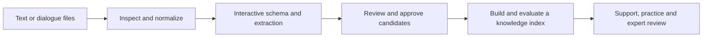

# TheraSkillAgent

TheraSkillAgent is a local, skill-based workspace for therapeutic text and
knowledge workflows. It combines deterministic text processing with optional
OpenAI-compatible LLM and embedding services, so the same project can ingest
messy dialogue transcripts, run structured extraction and review, build
traceable knowledge indexes, and support scenario practice.

The project is designed for human-controlled workflows. Model outputs remain
reviewable artifacts or governed candidates until an explicit approval step
publishes them. Model weights, private conversations, credentials, and full
knowledge releases are kept outside the source repository.

[中文说明](README.zh.md) · [English deployment guide](docs/deployment.en.md) ·
[中文部署说明](docs/deployment.zh.md) · [Workflow guide](docs/workflows.en.md) ·
[Changelog](CHANGELOG.md)

## What it provides

| Workflow | Main capabilities |
| --- | --- |
| Transcript workbench | Ingest TXT/JSON/CSV/Markdown or pasted text, normalize turns, inspect speaker roles, analyze risk signals, run skill reviews, and package evidence-preserving artifacts. |
| Interactive extraction | Inspect sources, propose and edit schemas, confirm sample/full runs, hand off to governance, and build and activate reviewed knowledge versions. |
| Knowledge and retrieval | Accept compatible JSONL, build portable lexical or hybrid indexes, verify checksums, search, activate, roll back, and package resources. |
| Skills and agent tasks | Model-directed tools, interactive questions and approvals, durable checkpoints, retries/cancellation, local skill installation, evolution drafts and rollback. |
| Behavioral evaluation | Execute fixed bilingual cases with real retrieval and models; inspect citations, score explanations, baseline comparisons and human-reviewed version gates. |
| Courses and progress | Define objectives, assign approved scenarios, link real practice and debriefs, record instructor reviews and track observations across attempts. |
| Practice and review | Run support, simulation, expert review, contribution, and extraction services from the same workbench and skill/tool surface. |

The browser workbench is served by the project itself. It exposes the main
workbench plus support, simulation, and expert views. All six business modules
run inside one process and share one browser port; no separate domain servers
are needed. The workspaces support Chinese/English switching while preserving
source text and evidence quotations.

## From source dialogue to reusable knowledge



Skills coordinate tools and pause for decisions when a task needs schema choices,
source clarification or approval. Transcript analysis and review can also run
directly. Model-generated knowledge and skill drafts stay reviewable; replacing
an active index or an existing skill requires a reviewed behavior comparison.

## Quick start from source

Use Python 3.11 or newer. Node 22.12 or newer is needed only when building the
browser interfaces from a source checkout.

```bash
git clone https://github.com/roytian1992/TheraSkillAgent.git
cd TheraSkillAgent

python -m venv .venv
source .venv/bin/activate
python -m pip install -e .

# Build the browser workspaces in a source checkout.
npm ci
npm run build

# Create a writable project layout, then start the local workbench.
theraskill-agent project init .
cp configs/theraskill/providers.local.example.yaml \
  configs/theraskill/providers.local.yaml
chmod 600 configs/theraskill/providers.local.yaml
# Edit that file with your LLM and embedding model names, URLs and keys.
theraskill-agent provider check --kind llm
theraskill-agent provider check --kind embedding
theraskill-agent ui
```

Open <http://127.0.0.1:5176/>. A wheel installation already contains built
interfaces and does not require Node. See [Deployment](docs/deployment.en.md)
for installation, startup, checks, and upgrades.

## Configure models directly

The only supported provider file shape is `active` plus one direct `llm` block
and one direct `embedding` block. The model names, URLs, and credentials are
independent:

```yaml
active:
  llm: local_llm
  embedding: local_embedding

llm:
  model: your-llm-model
  base_url: https://your-llm-service/v1
  api_key: "LLM_API_KEY"

embedding:
  model: your-embedding-model
  base_url: https://your-embedding-service/v1
  endpoint: https://your-embedding-service/v1/embeddings
  api_key: "EMBEDDING_API_KEY"
```

Put machine-specific values in the ignored
`configs/theraskill/providers.local.yaml`. The shared
`configs/theraskill/providers.yaml` contains safe local defaults. There is no
provider catalog to edit and no environment-variable model switch. A legacy
`profiles` registry is rejected with an actionable configuration error.

Use the provider commands to inspect redacted metadata or make a bounded live
request:

```bash
theraskill-agent provider list
theraskill-agent provider check --kind llm --live
theraskill-agent provider check --kind embedding --live
```

## Try a model-free knowledge workflow

The included six-record bilingual JSONL file is synthetic and only demonstrates
the schema. Lexical indexing does not call a model and does not require FAISS:

```bash
theraskill-agent index plan --knowledge examples/knowledge/demo.jsonl
theraskill-agent index build --knowledge examples/knowledge/demo.jsonl --id demo-v1
theraskill-agent index verify --index demo-v1
theraskill-agent index search --index demo-v1 --query uncertainty
theraskill-agent knowledge activate --index demo-v1
```

For hybrid retrieval, install the optional extra and use the active embedding
block from `providers.yaml`:

```bash
python -m pip install -e '.[retrieval]'
theraskill-agent index build --knowledge examples/knowledge/demo.jsonl \
  --id demo-hybrid --mode hybrid
```

Use `--resume` after an interrupted build with the same input and direct model
configuration. Changing the embedding model or dimensions requires a new
index. See [Knowledge, indexes, and resource packages](docs/knowledge_and_indexes.en.md)
for mappings, eligibility rules, manifests, installation, and rollback.

## Retrieval follows the task

Shared query understanding identifies language, concepts, task and risk cues.
Advanced agent retrieval adds real LLM planning, then combines lexical, label,
vector and required-family evidence within the selected skill's knowledge scope.
User filters remain hard constraints during scope relaxation and backfill.

Independent channels run in parallel. Index-versioned metadata caches avoid
repeated corpus scans, and scoped FAISS searches read Flat indexes through
read-only memory mapping. Cached metadata does not replace model planning.
Timings, evidence roles and warnings are saved with the result. Broad queries
and provider latency can still be slow; see the
[retrieval validation record (Chinese)](docs/retrieval_optimization_20261018.zh.md)
for measured cases and limits.

## Transcript and task examples

```bash
# Deterministic operations are local and do not call a model.
theraskill-agent text normalize dialogue.txt
theraskill-agent text sections dialogue.txt
theraskill-agent transcript inspect dialogue.txt
theraskill-agent transcript analyze dialogue.txt

# Review first creates a plan. Model review is a separate, explicit step.
theraskill-agent transcript review dialogue.txt --mode plan \
  --skill transcript-quality-reviewer
theraskill-agent transcript review dialogue.txt --mode model \
  --skill transcript-quality-reviewer --max-turns 200
```

The browser workbench exposes the same operations and provides approval points
for model-backed review and resource activation. Skills use the same tool and
task contracts whether they are invoked by the CLI, UI, or a local agent task.

## Repository and data boundaries

The repository contains the agent kernel, domain services, built-in skills,
prompts, schemas, indexing code, UI source, configuration templates, and small
synthetic examples. Full extracted knowledge, prebuilt indexes, persona and
scenario collections, model weights, raw research data, credentials, sessions,
logs, and runtime state are separate resources.

`releases/catalog.json` records whether optional packages are available. The
current source distribution does not publish the full knowledge or simulation
collections. Do not treat the demo records as clinical guidance or a validated
knowledge base.

Useful references:

- [Knowledge formats and index packages](docs/knowledge_and_indexes.en.md)
- [English deployment guide](docs/deployment.en.md)
- [中文部署说明](docs/deployment.zh.md)
- [Source/release boundaries](docs/source_release.zh.md)
- [Extraction datasets and outputs](extraction/docs/datasets_and_outputs.zh.md)

## Development and validation

```bash
python -m pip install -e '.[dev,retrieval]'
python -m pytest -q -o addopts='' \
  tests/test_standalone_kernel.py tests/test_theraskill*.py \
  tests/smoke_theraskill_install.py \
  --ignore=tests/test_theraskill_agent_regression.py
npm run build
python -m build
```

The base installation intentionally avoids heavyweight model and retrieval
frameworks. Install the `retrieval` extra only when FAISS-backed hybrid indexes
are needed. Software is MIT licensed; dataset, model, and source-conversation
terms remain separate.
