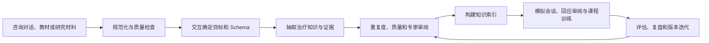

# TheraSkillAgent

TheraSkillAgent 是一个面向**心理咨询与心理治疗训练、研究和知识工程**的本地 Agent 工作台。

它把心理治疗知识、咨询对话处理、模拟来访者、咨询技能练习、专家审阅和课程评估连接成一条可复用的工作流。研究者可以从对话或其他授权材料中整理和抽取知识，教师可以创建课程和模拟患者，学习者可以进行会谈练习并获得结构化反馈，开发者可以通过 Skill、知识索引和可配置模型扩展整个平台。

TheraSkillAgent 不是一个只会生成回复的聊天界面。它关注的是心理治疗训练中的**过程、证据、交互和复盘**：模型需要在合适的阶段提问、澄清、调用工具、等待确认，并把输入、知识来源、技能版本和评估结果保存下来。

[English README](README.md) · [中文部署说明](docs/deployment.zh.md) · [English deployment guide](docs/deployment.en.md) · [模拟患者说明](docs/simulated_patients.zh.md) · [课程 Agent 设计](docs/course_agent_design.zh.md) · [资源安装说明](docs/resource_installation.zh.md)

复杂设计和评审任务分阶段生成、核验与修复。患者和对话评估可查看后台进度、失败恢复；课程批次展示计划和覆盖。详见[证据检查与任务恢复](docs/workflow_reliability.zh.md)。

## 它解决什么问题

心理咨询训练通常需要同时处理四类工作：

1. **理解对话**：把语音转录或格式不统一的咨询对话整理成可分析的轮次、说话人和证据片段。
2. **组织治疗知识**：从授权的对话、教材、研究资料或结构化数据中抽取干预原则、过程规则、治疗师技能和案例证据，并建立可检索索引。
3. **练习和反馈**：用可编辑、可复用的模拟来访者练习共情、开放式提问、认知重构、风险识别等技能，再对过程和回应进行评估。
4. **持续改进课程**：把场景、知识、Skill、评估案例和教师反馈放在同一个版本化流程中，支持复盘和迭代。

项目把这四类工作放在同一个 Agent 运行时里，减少从数据处理到训练应用之间的手工交接。

## 核心工作流



每一步都可以由界面、CLI 或 Skill 触发。需要用户决定 Schema、确认试抽结果、批准候选或处理冲突时，任务会暂停并保存检查点，之后可以继续执行。

## 主要能力

| 工作区 | 输入 | 输出 |
| --- | --- | --- |
| **对话分析** | TXT、Markdown、JSON、CSV、SRT、VTT、粘贴文本 | 规范化轮次、说话人映射、风险线索、质量审阅和可追溯分析包 |
| **知识抽取** | 对话文件、目录、JSONL 或其他可注册数据适配器 | 抽取目标、可编辑 Schema、样例结果、证据引用、候选知识包和治理任务 |
| **知识与索引** | 通过审核的 JSONL 知识 | 词法或 hybrid 索引、清单、检索结果、版本激活和回滚记录 |
| **模拟患者** | 训练主题、患者档案、近期经历、训练目标 | 可版本化的模拟患者、渐进披露规则、可复用情景和练习会话 |
| **技能与任务** | 自然语言目标、Skill、工具和知识范围 | 带澄清、工具轨迹、审批、检查点、重试和恢复的持久任务 |
| **专家审阅** | 治疗师回应、对话、知识候选或 Skill 草稿 | 结构化评估、证据引用、质量意见、重复度检查和发布门禁 |
| **课程与评估** | 课程目标、场景集合、学习者练习和教师反馈 | 批量场景、练习记录、复盘、行为评估、回归案例和学习进展 |

## 从备课到练习与反馈

在「课程与学习进展」中，可以先和课程 Agent 讨论教学目标，再从双语课程起点调整目标、知识卡与短练习，最后分配已审核的模拟案例。学员先练一段回应，再进入完整会谈，保存反思，并查看对应自己原话的反馈。课程 Agent 的交互边界和确认流程见[课程 Agent 设计](docs/course_agent_design.zh.md)。

平台配置的 LLM 按目标逐项评阅，结合课程量规和适用的检索知识，校验对话及知识引文；未观察到的行为不强行打分。教师判断独立保留，进展同时记录提示条件、案例难度和量规版本。详见[课程与学习指南](docs/learning.zh.md)。

## 为什么需要 Agent 和 Skill

心理治疗训练不是一次性生成文本：

- 不同任务需要不同知识范围，例如风险识别、治疗回应审阅和模拟患者生成不能共用同一组检索结果。
- 对话分析经常需要先确认说话人、语言、文本修正策略和输出 Schema。
- 知识抽取需要试抽、人工确认和治理；不能把一次模型输出直接当作正式知识。
- 模拟患者需要维护背景、近期事件、隐藏顾虑、披露层级和病例版本。
- 评估任务需要保留原始输入、工具调用、引用、模型配置和评分依据，方便复盘。

Skill 描述任务目标、输入输出、工具、知识范围和检查要求；Agent 负责选择和执行 Skill，并在需要时与用户交互。当前内置 Skill 包括：

- **对话与文本**：`transcript-normalizer`、`transcript-evaluator`、`transcript-quality-reviewer`
- **知识工程**：`dynamic-knowledge-extraction`、`knowledge-index-manager`
- **模拟训练**：`simulated-patient-builder`、`synthetic-dialogue-builder`
- **治疗回应与支持**：`therapy-response-reviewer`、`emotional-support`、`cognitive-reframing-support`、`rebt-belief-work-support`、`risk-triage`
- **运行管理**：`theraskill-agent-operator`

## Skill、Task、Workspace 和 Runtime 的关系

这四个词描述的是不同层次，不能互相替代：

| 层次 | 作用 | 你什么时候会接触它 |
| --- | --- | --- |
| **Skill** | 一套可复用的方法，规定目标、输入输出、工具、知识范围和检查要求 | 安装、检查或改进一种能力，例如对话规范化、知识抽取或模拟患者构建 |
| **Task** | 一次具体、可恢复的执行实例，记录输入、规划、工具调用、人工确认、检查点和结果 | 开始一次抽取、评估、技能执行或批量生成，并在“任务与历史”查看进度 |
| **Workspace** | 面向人的业务入口，把业务目标和结果组织成可操作的页面 | 在对话分析、知识抽取、模拟训练、专家审阅等页面中工作 |
| **Runtime** | 执行基础设施，负责选择 Skill、调用工具、保存状态、等待交互、恢复和审计 | 通常由系统自动使用；需要观察或控制执行时进入“Agent 任务流” |

因此，界面里的“Agent 任务流”不是另一套业务流程，也不是普通聊天记录。它是运行层的可视化入口：你可以从目标创建一个 Task，让 Agent 选择或执行 Skill，在需要决定时提供输入，并查看完整的执行时间线。业务工作区负责表达“要完成什么”，Skill 负责描述“如何完成”，Task 负责记录“这一次完成得怎样”。

## 模拟患者和情景训练

模拟患者不是一段固定人设，而是一个可编辑、可复用的病例版本。档案可以包含：

- 基本背景与当前困扰；
- 生活背景和近期经历；
- 患者目标、训练目标和隐藏顾虑；
- 表达习惯、沟通风格和披露偏好；
- 事件时间、影响、稳定 ID 和披露层级。

训练时，患者模型只接收当前允许披露的事实。教师可以从界面构建或修改患者、复制为新场景、保存新版本，并把场景分配到课程中。详见[模拟患者使用说明](docs/simulated_patients.zh.md)。

## 界面和运行方式

启动后，统一工作台提供以下入口：

- **工作台**：进入专业工作区和运行状态；
- **任务与历史**：优先查看正在执行和需要处理的技能、抽取、专家及情景批次任务，支持历史筛选、结果重开和归档；关联的抽取步骤归到同一工作流下面；
- **模型与连接**：分别配置、测试和保存 LLM 与 embedding；
- **对话分析、知识抽取、知识与索引**：完成数据、知识和检索流程；
- **情景控制台、专家工作台、支持助手**：进行模拟训练、回应审阅和文本支持任务。

所有模块由一个本地应用进程管理，浏览器默认访问 `http://127.0.0.1:5176/`。不需要为每个业务模块单独启动一组服务。

### 支持助手与证据

支持助手不会为每一轮对话都启动知识抽取。问候、确认以及明确的产品导航问题会走有边界的轻量路径，通常只调用一次回复模型，不做检索。心理问题或已有安全上下文的对话仍会执行安全筛查、技能路由、策略检索和有依据的回复。消息会明确显示本轮是跳过检索，还是检索后没有可用依据。

回复里的「参考依据」可以展开查看结构化知识内容。详情抽屉会区分本次引用的索引段落和可编辑的来源字段，并链接到「知识与索引」工作区。保存修改会生成按版本和索引范围隔离的草稿；「重新生成索引」提交持久任务，生成新的候选索引，活动索引不会被原地修改。候选完成后仍需验证、效果回归和启用；任务链接可用于查看进度、失败原因和恢复任务。

## 快速开始

Python 需要 3.11+。从源码构建浏览器界面需要 Node 22.12+；使用 wheel 时不需要 Node。

```bash
git clone https://github.com/roytian1992/TheraSkillAgent.git
cd TheraSkillAgent

python -m venv .venv
source .venv/bin/activate
python -m pip install -e .

# 源码安装需要构建界面
npm ci
npm run build

theraskill-agent project init .
cp configs/theraskill/providers.local.example.yaml \
  configs/theraskill/providers.local.yaml
chmod 600 configs/theraskill/providers.local.yaml

theraskill-agent ui
```

打开 `http://127.0.0.1:5176/`，在“模型与连接”页面配置模型并测试连接。完整的安装、升级和故障排查见[中文部署说明](docs/deployment.zh.md)。

## 模型配置

LLM 和 embedding 使用两个独立的直接配置块，模型名、URL 和密钥可以分别设置：

```yaml
active:
  llm: local_llm
  embedding: local_embedding

llm:
  model: 你的LLM模型名
  base_url: https://你的LLM服务/v1
  api_key: "LLM_API_KEY"

embedding:
  model: 你的Embedding模型名
  base_url: https://你的Embedding服务/v1
  endpoint: https://你的Embedding服务/v1/embeddings
  api_key: "EMBEDDING_API_KEY"
```

本机配置放在被 Git 忽略的 `configs/theraskill/providers.local.yaml`。项目兼容本地服务和 OpenAI-compatible API，例如本地 Qwen/BGE 或远程 LLM/embedding 服务。

也可以使用 CLI 检查配置：

```bash
theraskill-agent provider list
theraskill-agent provider check --kind llm --live
theraskill-agent provider check --kind embedding --live
```

## 知识资源和索引

仓库内的 `examples/knowledge/demo.jsonl` 是一个小型格式示例，可以在没有模型的情况下建立词法索引：

```bash
theraskill-agent index plan --knowledge examples/knowledge/demo.jsonl
theraskill-agent index build --knowledge examples/knowledge/demo.jsonl --id demo-v1
theraskill-agent index verify --index demo-v1
theraskill-agent index search --index demo-v1 --query uncertainty
```

完整的知识和情景素材作为独立资源包提供，安装后可以通过界面或 CLI 构建索引。资源包不与源码仓库混在一起，便于按数据授权、版本和机器容量管理。详见[知识、索引和资源包说明](docs/knowledge_and_indexes.zh.md)与[资源安装说明](docs/resource_installation.zh.md)。

## 开发和验证

```bash
python -m pip install -e '.[dev,retrieval]'
python -m pytest -q -o addopts='' \
  tests/test_standalone_kernel.py tests/test_theraskill*.py \
  --ignore=tests/test_theraskill_agent_regression.py

cd views/theraskill/workbench
npm ci
npm run build
```

代码、提示词、Skill、索引构建器和界面源码都在本仓库中。模型权重、原始患者资料、机构数据和完整知识资源按项目部署单独提供。

## 项目边界

TheraSkillAgent 面向心理咨询与心理治疗的研究、教学、训练和内容工程。真实临床使用需要机构流程、数据授权和专业人员参与；仓库不包含真实患者资料，也不把合成场景当作临床诊断或治疗结论。

软件采用 MIT License。数据集、研究材料、模型和心理健康内容的授权条款分别由其来源决定。
