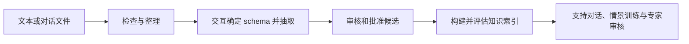

# TheraSkillAgent

TheraSkillAgent 是一个面向治疗文本和知识流程的本地 skill-based agent
工作台。它把确定性的文本处理、可配置的 LLM/embedding 服务、知识抽取、
对话评估、情景训练、审核和知识索引放在同一个项目里。

项目强调人工可控：模型输出先保存为可追溯的产物或候选，经过质量检查和
明确审批后才进入正式知识发布。模型权重、患者对话、密钥和完整知识库均
不随源码仓库分发。

[English README](README.md) · [English deployment guide](docs/deployment.en.md) ·
[中文部署说明](docs/deployment.zh.md) · [工作流使用说明](docs/workflows.zh.md) ·
[资源 ZIP 安装](docs/resource_installation.zh.md) · [更新记录](CHANGELOG.md)

## 能做什么

| 工作流 | 能力 |
| --- | --- |
| 对话工作台 | 导入 TXT/JSON/CSV/Markdown/SRT/VTT 或粘贴文本，整理轮次和说话人，分析风险信号，执行多 skill review，打包保留证据链的结果。 |
| 交互式抽取 | 检查来源，按目标建议和编辑 schema，确认试抽/全量，交接治理，构建并启用经过审核的知识版本。 |
| 知识与检索 | 接收合格 JSONL，构建词法或 hybrid 索引，校验清单，检索、启用、回滚和打包资源。 |
| Skill 与任务 | 模型驱动工具调用、交互提问与确认、持久检查点、重试/取消，以及技能安装、优化草稿和回滚。 |
| 效果回归 | 生产 TaskEngine 实际执行 12 个可编辑中英文案例，保留工具与交互轨迹、引用、评分、基线对比和人工门禁。 |
| 课程与进展 | 定义目标、分配已审核场景、关联真实练习与复盘，记录教师复核并查看历次观察。 |
| 训练与审核 | 从同一个工作台启动支持、情景模拟、专家审核、贡献和抽取服务。 |

界面由项目自身提供：主工作台、支持、模拟、专家页面与六个业务模块共用
一个进程、一个网页端口，启动时无需分别管理领域服务。各工作区支持中英文
切换，原文和证据引文保持原样。

## 安装完整知识和情景资源

维护者另外提供 **TheraSkillAgent-resources-phase6-20261019.zip**。内附 0.5.0 安装 wheel，无需 Node。先解压外层交付包，再按包内 README / 本地 catalog 安装两个内层资源 ZIP。包内包括 **2,196,286 条知识发布记录与情景素材**，附清单、SHA-256 和来源说明；不包含模型权重或预构建向量索引。

完整命令、界面上传方式、空间需求和索引构建见[资源安装说明](docs/resource_installation.zh.md)。当前尚无公共下载链接，由维护者手动提供。

## 从原始对话到可复用知识



Skills 协调工具执行，在需要确定 schema、澄清来源或审批时暂停交互。
也可以直接进行对话分析和审核。模型生成的知识和技能草稿保留待复核状态；
替换活动索引或已有技能需要人工复核的效果对比报告。

## 快速开始

Python 需要 3.11+。从源码构建界面需要 Node 22.12+；安装 wheel 时不需要
Node。

```bash
git clone https://github.com/roytian1992/TheraSkillAgent.git
cd TheraSkillAgent

python -m venv .venv
source .venv/bin/activate
python -m pip install -e .

# 源码安装需要构建浏览器界面
npm ci
npm run build

theraskill-agent project init .
cp configs/theraskill/providers.local.example.yaml \
  configs/theraskill/providers.local.yaml
chmod 600 configs/theraskill/providers.local.yaml
# 编辑该文件，填写 LLM 和 embedding 各自的模型名、URL 和密钥
theraskill-agent provider check --kind llm
theraskill-agent provider check --kind embedding
theraskill-agent ui
```

浏览器打开 `http://127.0.0.1:5176/`。完整的 wheel 安装、启动、检查、
升级和故障检查见 [英文部署文档](docs/deployment.en.md) 或
[中文部署文档](docs/deployment.zh.md)。

## 模型配置

项目只支持一种 provider 配置结构：`active` 加两个直接配置块 `llm` 和
`embedding`。两类模型的模型名、URL 和密钥相互独立：

```yaml
active:
  llm: local_llm
  embedding: local_embedding

llm:
  model: 你的LLM模型名
  base_url: https://你的LLM服务/v1
  api_key: "LLM_API_KEY"

embedding:
  model: 你的Embedding模型名
  base_url: https://你的Embedding服务/v1
  endpoint: https://你的Embedding服务/v1/embeddings
  api_key: "EMBEDDING_API_KEY"
```

机器相关配置放到被 Git 忽略的
`configs/theraskill/providers.local.yaml`。共享的
`configs/theraskill/providers.yaml` 只提供安全的本地默认值。旧的
`profiles` 注册表会直接报错，不会被静默转换。

```bash
theraskill-agent provider list
theraskill-agent provider check --kind llm --live
theraskill-agent provider check --kind embedding --live
```

不加 `--live` 时不会访问网络；展示结果会隐藏密钥。

## 不启动模型也能试用知识流程

仓库包含 6 条中英双语 synthetic JSONL 记录，仅用于演示格式。词法索引
不调用模型，也不需要 FAISS：

```bash
theraskill-agent index plan --knowledge examples/knowledge/demo.jsonl
theraskill-agent index build --knowledge examples/knowledge/demo.jsonl --id demo-v1
theraskill-agent index verify --index demo-v1
theraskill-agent index search --index demo-v1 --query uncertainty
theraskill-agent knowledge activate --index demo-v1
```

需要 hybrid 检索时安装可选依赖，系统会使用 `providers.yaml` 的
`embedding` 块：

```bash
python -m pip install -e '.[retrieval]'
theraskill-agent index build --knowledge examples/knowledge/demo.jsonl \
  --id demo-hybrid --mode hybrid
```

中断后使用相同输入和直接模型配置加 `--resume`。更换 embedding 模型或
维度后应新建索引。字段映射、候选资格、索引清单、资源安装和回滚见
[知识、索引与资源包](docs/knowledge_and_indexes.zh.md)。

## 按任务检索知识

共享查询理解识别语言、概念、任务与风险线索。高级 Agent 检索继续调用真实
LLM 规划，在选定技能的知识范围内融合词法、标签、向量和必要知识家族。
用户指定的过滤条件在放宽模型建议范围和回填候选时始终生效。

独立召回通道并行执行，按索引版本缓存元数据以减少重复扫描；FAISS 通过
只读映射和范围选择器读取 Flat 索引。元数据缓存不会替代模型规划。
结果保存耗时、证据用途与警告；宽泛查询和模型服务仍可能较慢。
真实测量及边界见[检索优化验收](docs/retrieval_optimization_20261018.zh.md)。

## 对话与任务示例

```bash
# 确定性操作只在本地执行
theraskill-agent text normalize dialogue.txt
theraskill-agent text sections dialogue.txt
theraskill-agent transcript inspect dialogue.txt
theraskill-agent transcript analyze dialogue.txt

# 先生成 review 计划，再显式执行模型 review
theraskill-agent transcript review dialogue.txt --mode plan \
  --skill transcript-quality-reviewer
theraskill-agent transcript review dialogue.txt --mode model \
  --skill transcript-quality-reviewer
```

CLI、界面和 skill/tool 调用共用相同的任务和结果契约，
审核和资源启用都保留明确的人工操作节点。

## 仓库与数据边界

源码仓库包含 agent 内核、领域服务、内置 skills、提示词、schema、索引代码、
界面源码、配置模板和小型 synthetic 示例。完整知识库、预构建索引、persona、
情景素材、模型权重、原始研究数据、密钥、会话、日志和运行状态均作为独立
资源管理。

`releases/catalog.json` 记录可下载资源的发布状态。完整知识和模拟素材
没有公开下载地址；示例数据不代表临床指南或经过验证的知识库。

参考文档：

- [知识格式、索引和资源包](docs/knowledge_and_indexes.zh.md)
- [英文部署文档](docs/deployment.en.md)
- [中文部署文档](docs/deployment.zh.md)
- [源码发布边界](docs/source_release.zh.md)
- [数据集抽取与产出说明](extraction/docs/datasets_and_outputs.zh.md)

## 开发与验证

```bash
python -m pip install -e '.[dev,retrieval]'
python -m pytest -q -o addopts='' \
  tests/test_standalone_kernel.py tests/test_theraskill*.py \
  tests/smoke_theraskill_install.py \
  --ignore=tests/test_theraskill_agent_regression.py
npm run build
python -m build
```

基础安装不包含重量较大的模型和检索框架；只有需要 FAISS hybrid 索引时才
安装 `retrieval` extra。软件采用 MIT 许可证，数据、模型和患者对话的授权
需要分别确认。
