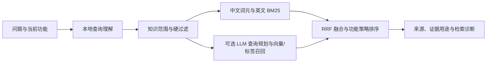

# 知识、索引与独立资源包

## 输入

接受 Phase 6 发布 JSONL（`release_unit_id`、`content`、`retrieval_policy`）以及通用 JSONL（见 `schemas/knowledge.schema.json`）。原始数据集和旧研究目录不是依赖。通用格式至少包含稳定 `id`、`title` / `text`；默认候选不参与检索，需 `review_status=approved/released` 且检索策略明确允许。构建本身不会审批候选。

原字段不同可使用 JSON 映射文件，如 `{"id":"record.id","text":"content.summary"}`，CLI 传 `--mapping mapping.json`；这是字段路径映射，不执行自定义代码。

`examples/knowledge/demo.jsonl` 是自编小样例。完整知识与模拟素材单独发布，当前没有公共下载链接。

## 构建和查询

```bash
theraskill-agent index plan --knowledge examples/knowledge/demo.jsonl
theraskill-agent index build --knowledge examples/knowledge/demo.jsonl --id demo-v1
theraskill-agent index verify --index demo-v1
theraskill-agent index search --index demo-v1 --query uncertainty
theraskill-agent knowledge activate --index demo-v1
theraskill-agent knowledge list
```

默认产物位于 `data/theraskill/indexes/<id>/`。词法构建生成主 FTS、metadata 和 compact-label 三个 SQLite 文件，保留旧检索器使用的来源与路由字段。不会调用 LLM 或 embedding 服务，也不要求安装 NumPy / FAISS。

```bash
pip install -e '.[retrieval]'
theraskill-agent index plan --knowledge examples/knowledge/demo.jsonl --mode hybrid
theraskill-agent index build --knowledge examples/knowledge/demo.jsonl --id demo-bge --mode hybrid
theraskill-agent index search --index demo-bge --query uncertainty
```

`plan` 扫描输入并估计请求量，不发 embedding 请求。磁盘估算为粗略的词法估算，向量另需空间。完整文件的扫描和 hash 会耗时。`build` 才调用 `providers.yaml` 的 `embedding` 服务；可在该块设置 `dimensions`、`batch_size`、`revision`。`dimensions` 会发送给服务，并验证响应。模型服务不提供 revision 时应自行维护配置版本，系统无法识别同名服务在后台静默换权重。

## 查询理解和功能路由



Agent 工具、支持助手、CLI 和知识工作台共用查询理解与功能策略。查询理解统一 Unicode 和常见转录标点，识别中文、英文或混合语言，提取任务类型、风险用语、概念与有限查询变体。只对实际出现的概念作中英文扩展，例如「灾难化」扩展为 cognitive reframing / alternative thought；不是把每个 skill 的所有关键词都拼进问题。没有明确功能时返回 `suggested_skill`；已有功能选择保持明确，不会被关键词静默覆盖。风险线索用于路由提示，不是最终风险判断。

本地层不调用模型。高级 hybrid 路径在其上调用现有 LLM planner，补充上下文理解和查询改写；LLM / embedding 不可用时运行带相同功能策略的词法回退，并报告原因。仅标点等信息不足的查询返回 `needs_clarification` 和空结果。

planner 提示词注入当前索引的真实元数据值，避免自行编造知识类型或证据等级。JSON 或元数据校验失败时，默认最多进行两次真实模型尝试（独立 planner CLI 可用 `--validation-attempts` 设置 1–3 次），记录每次状态、索引值清单与提示词 hash。仍失败则明确进入已有的策略词法回退，不把无效计划标记为成功。模型仅被要求紧凑输出，不在本地截断答案。

| 功能 | 知识范围重点 |
| --- | --- |
| 支持对话 | 回应风格、咨询过程、心理教育 |
| 风险分流 | 临床风险评估、风险相关回应与心理教育 |
| 认知重构 | 方法 rubric、心理教育、回应风格与风险边界 |
| REBT | 方法 rubric、信念工作相关过程与心理教育 |
| 情景生成 | 合成对话方法、咨询过程、方法 rubric 与回应风格 |
| 回复审核 | 咨询过程、方法 rubric、构建审核方法、回应风格与心理教育 |

功能同时限制允许的知识家族和禁用路由；合成对话构建方法只进入生成或审核功能。候选/记账记录不能通过回填进入普通支持。路由偏好在范围内影响排序，显式 `filters` 则是硬约束：同一字段的多个值按 OR、不同字段按 AND 组合。支持 `family`、`language`、`dataset`、`evidence_tier`、`knowledge_type`、`route`、`risk` 及其标准元数据字段名。

硬约束在候选召回前生效。LLM 猜测的范围可以放宽；用户过滤和功能边界始终保留，包含 required-family 回填、policy 回填和最终融合。未知过滤字段或旧索引缺少所需列会明确报错，避免静默忽略。

FAISS 使用选择器在近邻选择前应用元数据范围，避免先取全局前 N 条再过滤时，符合语言等条件的知识被提前挤出候选池。

新索引在主 SQLite 中额外构建中文二、三字词元 FTS 表，解决默认 tokenizer 对连续中文召回不足的问题。无需安装中文分词包。历史索引仍可走子串回退，但可能较慢；用新 ID 重建索引才能启用中文词元索引和完整语言过滤。新增投影版本会产生新的索引身份，不复用旧构建检查点。默认不会把查询语言当成硬过滤，因此允许中英文知识互相召回。

```bash
# 不需要模型或索引，单独检查 query understanding
theraskill-agent index understand \
  --query '最近经常灾难化，想学习认知重构' \
  --skill cognitive-reframing-support

# 比较功能路由与语言约束
theraskill-agent index search --index demo-v1 \
  --query '核对原文证据' \
  --skill therapy-response-reviewer \
  --filters '{"language":"zh"}'
```

检索结果包含 `query_understanding`、`skill`、`retrieval_mode`、索引身份、命中记录与 warnings；高级 Agent 路径另有证据角色、允许/禁止用途、规划状态和策略检查。CLI / 工作台的索引测试使用本地 BM25 或 BM25+向量融合，不调用 LLM planner；Agent / 支持助手使用高级查询规划、标签、向量和策略重排，允许结果排序有所不同。

工作台可选择功能路由和语言过滤；结果直接展示查询理解、优先知识家族、识别概念、命中数量、语言和证据等级。LLM 与 embedding 分别读取 `providers.yaml` 的独立配置，不再显示无效的 embedding profile 名称输入。

中断后传相同参数并加 `--resume`。词法阶段中断会重建词法文件；已完成的 embedding 批次由 SQLite 事务保存，恢复时只补缺失记录。恢复前核对输入 hash、映射、投影版本、模型身份和已有词法文件；不兼容则拒绝。已完成索引不可覆盖，需使用新 ID。

输出清单记录所有文件 hash / 大小、输入知识 hash、模型身份、维度和覆盖数量。`total` 是知识总数，`indexed` 是可词法检索数量，`embedding_eligible` / `vectors` 是可嵌入 / 实际嵌入数量；不能把总知识数当向量数。

新增向量或更换 embedding 模型时，可用 `--reuse-lexical 已完成索引ID` 和新的输出 ID 复用词法文件。系统先验证源索引，要求知识 hash、投影版本和字段映射完全一致，再复制三个词法文件；不会复用其他模型的向量。界面混合构建也提供此选项。

直接 `embedding` 配置可设置 `batch_size` 和 `workers`（默认 1，最高 16）。请求可并发执行，但向量批次与恢复游标按来源顺序提交，避免后完成的失败批次被跳过。这两个吞吐设置不影响模型身份。取消时可能已有未提交的请求在执行，恢复可能重复这部分请求，但不会漏掉或重复保存知识 ID。

服务支持二进制 embedding 响应时，可在 provider 文件设置 `embedding.encoding_format: base64`，减少传输与 JSON 解析开销。仍支持浮点数组响应；传输编码不改变模型、维度或索引身份。

```bash
theraskill-agent index build --knowledge /path/to/knowledge.jsonl \
  --id knowledge-hybrid-v2 --mode hybrid --reuse-lexical knowledge-lexical-v2
```

## 安装、切换和界面

```bash
theraskill-agent knowledge install --archive /path/to/knowledge.tar.gz
theraskill-agent knowledge install --catalog /path/to/catalog.json --package demo
theraskill-agent knowledge activate --index demo-v1 --knowledge demo
theraskill-agent knowledge rollback
```

目录可以使用本地路径或 HTTPS URL，支持校验下载、分卷拼接和分卷断点继续。资源解包逐文件核对清单；拒绝路径越界、链接、重复成员或未声明文件。安装不会自动启用索引。下载前检查磁盘空间。取消下载保留已下载部分；本地解包进入原子安装阶段后会完成该阶段。

当前选择存储在 `active-index.json`，上一版本在 `previous-index.json`。知识版本与索引版本分别管理。切换新索引不覆盖原 `current` 知识发布物。支持助手、知识搜索工具和候选去重会读取当前选择；向量不匹配时拒绝使用，支持/搜索可回退到带策略的词法检索并报告原因。

工作台「知识与索引」提供 JSONL 上传（32 MiB 内）、本机大文件路径、构建任务、取消/恢复、包安装、校验、检索测试、启用/回滚和中英文切换。API 在现有 UI 服务的 `/api/resources`，无需新端口。后台任务写入 `state/resource-jobs`；单进程串行执行，索引目录另有进程锁。进程停止后任务显示中断，需显式继续。

`theraskill_resources` 工具与 `knowledge-index-manager` 技能使用同一任务实现，不需要界面服务才能调用。工具提交构建后返回 job ID，通过 `status` 获取最终结果。

## 单独打包

```bash
theraskill-agent knowledge pack --source examples/knowledge/demo.jsonl --output /tmp/demo.tar.gz --id demo --kind knowledge --license CC0-1.0
theraskill-agent knowledge pack --source data/theraskill/indexes/demo-v1 --output /tmp/demo-index.tar.gz --id demo-index --kind index
```

命令同时输出 `.download.json`，可把其中的记录放入 `catalog.json` 的 `packages` 数组。下载地址默认是相对压缩包文件名；上传后填写实际 URL。需要分卷时加 `--part-bytes 1073741824`，记录每卷顺序与 hash；分卷不可分别解压。完整包保留在本地便于核对。

打包知识需要明确数据许可，参数不会替你确认第三方数据的再分发权。预构建索引也可能含原文，需遵守相同来源限制。目前提供知识和索引的打包命令，模拟素材的专门打包入口仍待整理。公开 catalog 不填虚构 URL。
