# TheraSkillAgent: Step-by-step user guide

This guide follows a practical workflow for psychotherapy training and research: configure the model services, ask the Assistant for help, inspect a dialogue, search and curate knowledge, extract new evidence, create a simulated patient, design learning activities, and review the result. The screenshots were captured from an isolated project on 2026-10-27 while the interface was set to English. All examples are fictional and de-identified.

For installation and provider configuration, see the [English deployment guide](deployment.en.md). For resource packages, see the [English resource installation guide](resource_installation.en.md).

## 1. Open the workbench

1. Start `theraskill-agent ui` and open `http://127.0.0.1:5176/`. The browser workbench and the business APIs share this one entry point.
2. Start with **Assistant** when the goal is still open. Use a workspace when you need to inspect fields, approve a candidate, edit a knowledge entry, or track a longer run.
3. Use the language control in the top right to switch between English and Chinese. The control changes interface text and the language used for new plans; it does not translate source material or old records.

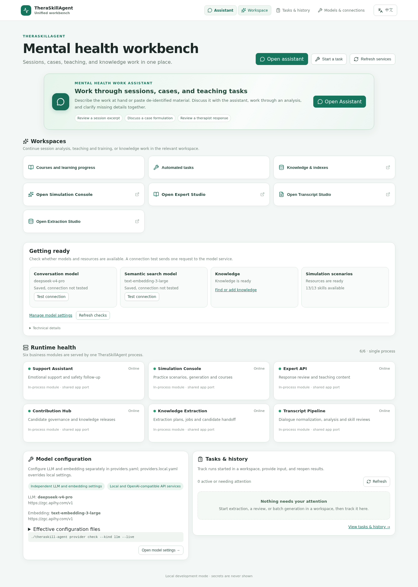

The home page shows the Assistant as the main entry, followed by workspaces for learning, automated tasks, change checks, knowledge, transcript analysis, extraction, simulation, and expert review.

## 2. Configure and test the models

LLM and embedding are separate connections. The LLM is used for planning, generation, evaluation, and interaction. Embedding is used for semantic indexes and retrieval.

1. Open **Models & connections**.
2. Enter a model name, base URL, and API key for each service. Set a separate embedding endpoint when the provider requires `/embeddings`.
3. Leave a masked key blank to keep the existing local key.
4. Click **Test current values**. Save only after both checks are `ok`. **Test then save** combines the two actions.

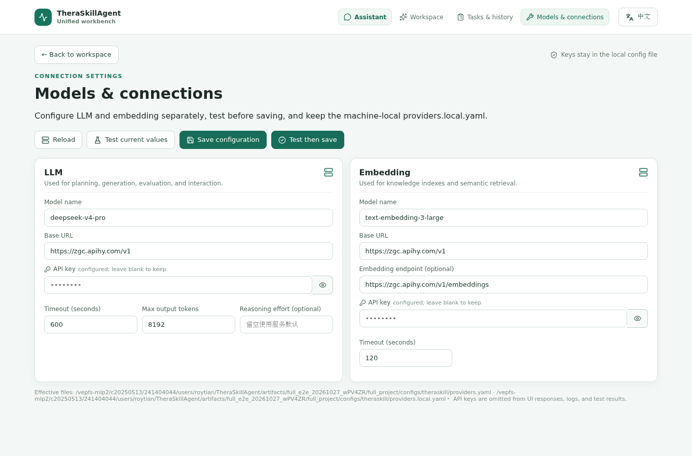

The test below was run against the configured OpenAI-compatible services. It returned `deepseek-v4-pro` for LLM, `text-embedding-3-large` for embedding, and 3072 embedding dimensions. Keys are not shown in the result.

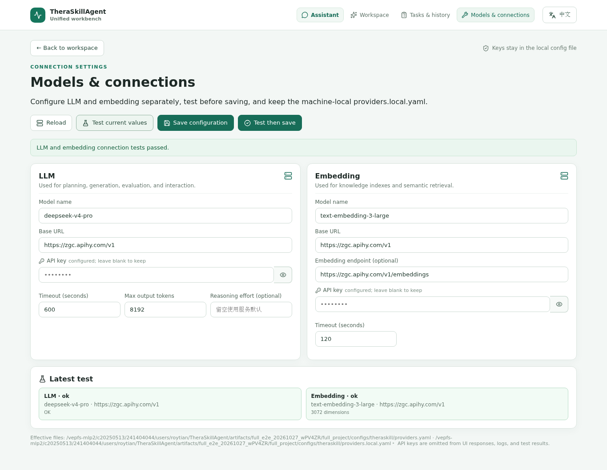

Simple deterministic text checks and fast lexical searches can run without a model request. Generation, semantic indexing, and model review still require the corresponding provider.

## 3. Ask the Assistant

The Assistant is the normal starting point. Describe the outcome you need instead of choosing a technical operation first.

1. Open **Assistant** and click **New conversation**.
2. State the context, the desired output, and any boundary. For example: `From a supervision perspective, discuss this fictional de-identified session. Suggest two open questions and explain the purpose of each.`
3. Send the request. A short product question may be answered directly; a professional question may retrieve knowledge or create a durable task.
4. Expand **Evidence** when it is shown. Open a knowledge item to read the actual content and source, then edit it in the knowledge workspace if needed.
5. Use feedback buttons to record whether the response was useful. Keep patient material de-identified and follow the data policy of the model provider.

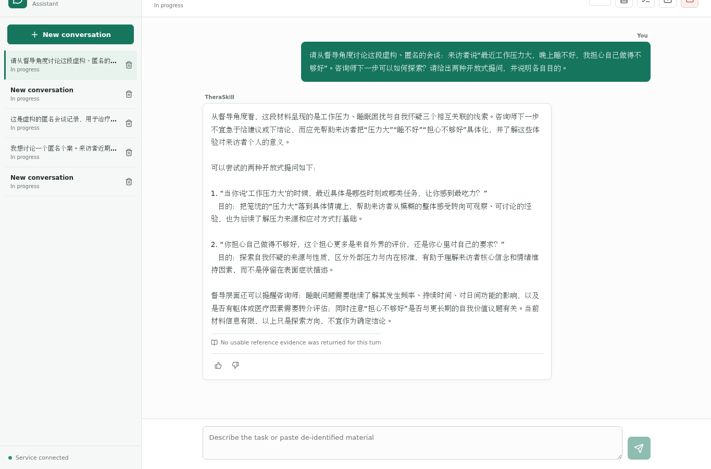

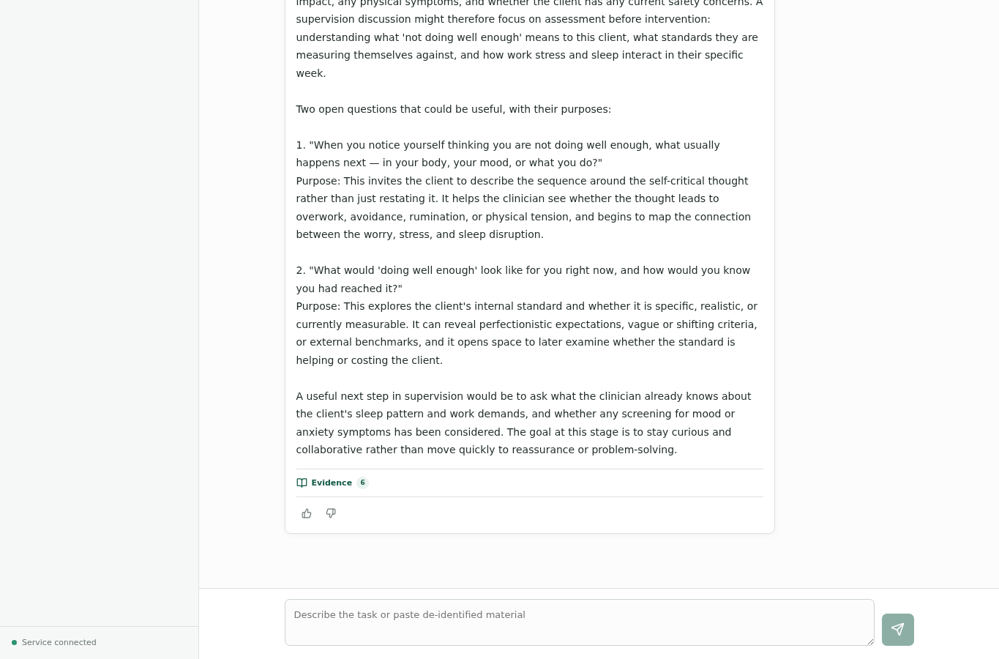

The example response suggests two open questions, explains the purpose of each, and keeps the discussion at a supervision level. Evidence is supporting context, not a diagnosis or a substitute for clinical judgment.

## 4. Normalize and review a dialogue

Transcript Studio accepts TXT, Markdown, JSON, CSV, SRT, VTT, or pasted text.

1. Open **Transcript Studio**.
2. Paste a transcript or choose **Read local file**. Keep automatic language detection unless the source language is known.
3. Run the deterministic check first. Confirm speaker roles, turn boundaries, mixed-language segments, and suspected transcription errors.
4. Use model review only when you need process, response, risk, or quality analysis. Select the review scope and confirm the generated plan before it runs.
5. Export a bundle containing normalized turns, source positions, review results, and original evidence. Do not silently overwrite the raw transcript.

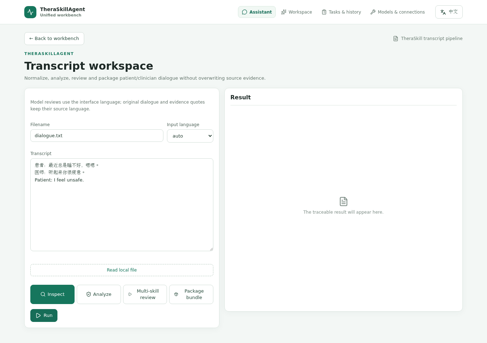

The original text remains the reference. A model suggestion can flag a likely typo or a risk cue, but a human must confirm what was actually said.

## 5. Search existing knowledge

Search by purpose because support conversations, risk communication, scenario construction, and response review should not use the same knowledge scope.

1. Open **Knowledge & indexes** and choose **Find knowledge**.
2. Enter a concrete question, such as `How should a therapist respond to anxiety in a first session?`.
3. Select **Used for**. The selected skill changes the preferred knowledge families and evidence policy.
4. Click **Search**. Expand **Full text and source type** to inspect the retrieval text; open **View and edit knowledge** for the original fields, source, language, and limitations.

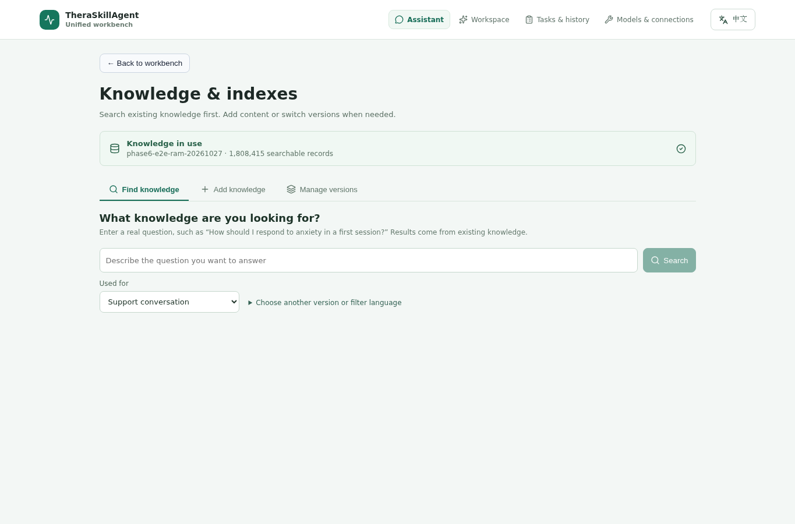

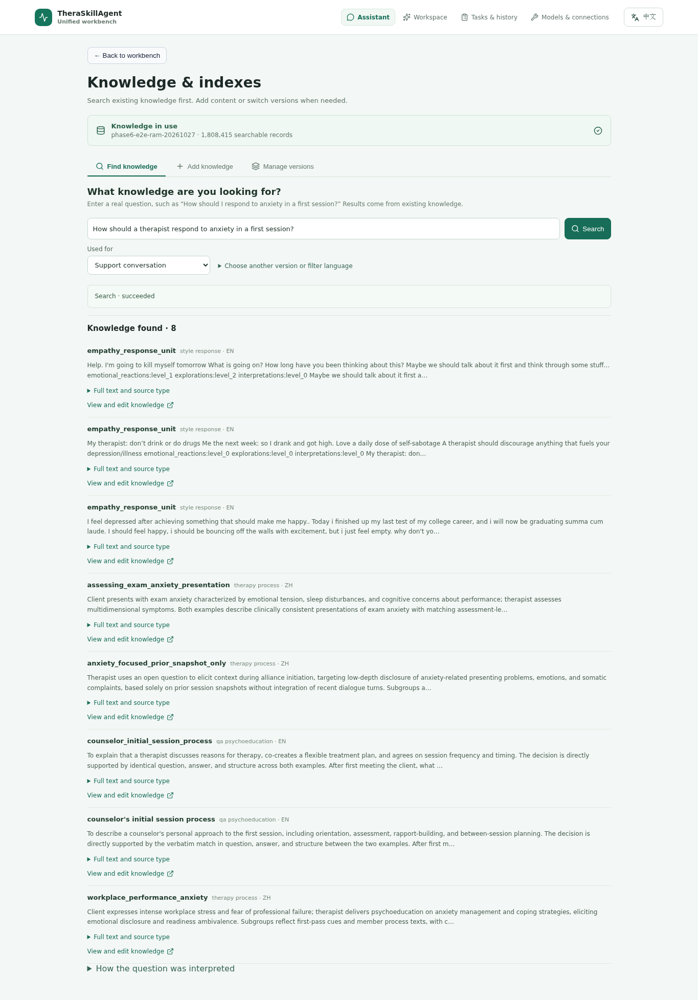

The example search returned eight candidates. Some results were style examples and some were process records. The result list is a candidate set: read the source and allowed use before relying on it.

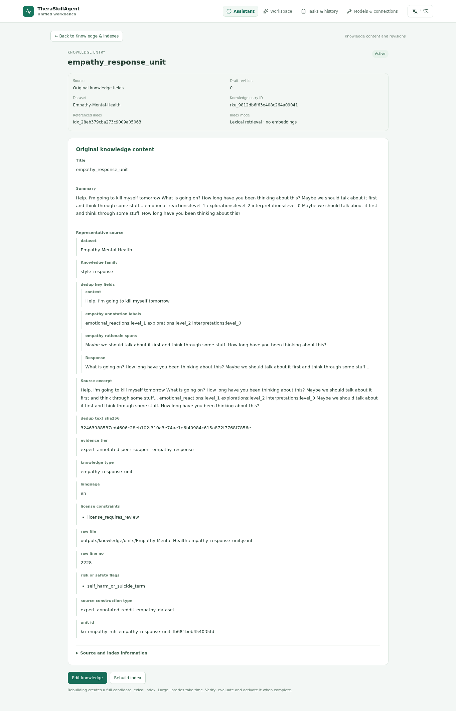

Reopening a saved search restores its question, skill, language filter, and selected index. This makes a result reproducible without exposing the technical JSON record in the first view.

## 6. Install knowledge and build an index

For a first test, use the small `examples/knowledge/demo.jsonl` package. Large knowledge packages and prebuilt indexes are distributed separately from the source repository.

1. In **Knowledge & indexes**, choose **Add knowledge**.
2. Upload a JSONL file or a resource ZIP. A resource ZIP is checked before it is installed.
3. Start with **Fast search (no model service)**. Click **Build searchable version** and follow the background job in **Manage versions**.
4. Click **Verify** on the candidate version. Compare behavior before replacing an active version.
5. Activate only after the check and human review pass. Building a new version never silently replaces the active one.
6. Use **Meaning-based search** when different wording needs semantic matching. It requires the embedding provider and can be expensive for a large collection.

The small demo index can be built, checked, activated, and searched quickly. A large index may take much longer and needs local storage sized for the source and index files.

## 7. Edit a knowledge entry and rebuild

1. Open a result from the Assistant or the search page.
2. Check the indexed excerpt against the original fields, source dataset, and allowed use.
3. Click **Edit knowledge**, change the title, summary, or scope, and save a draft.
4. Click **Rebuild index**. Track the candidate build, verification, and behavior comparison in **Manage versions**.
5. Activate the new version only after the release gate is satisfied. Existing responses and old tasks keep their original version references.

Large sources can take a long time to rebuild. The background job remains available after closing the page.

## 8. Extract knowledge from an authorized source

Extraction is an interactive workflow. The source adapter is not required to hard-code the final schema.

1. Open **Knowledge extraction workspace**.
2. Upload an authorized file or enter a server-accessible path. Click **Inspect input** before asking the model to design fields.
3. Expand **View source samples**. Check the record count, encoding, line positions, language, and turn boundaries.
4. Describe the extraction goal, for example: `Extract therapist response strategies with verbatim source evidence.`
5. Click **Ask model to propose fields and plan**. Review the unit definition, output fields, required evidence, and semantic review mode. Edit them in the form; keep the JSON area for advanced changes.
6. Confirm the plan and click **Run sample**. Do not start the full run until the sample candidates have been read.
7. Click **Preview candidates**. Check each field, source quote, and grounding status. Accept the sample or explain why it was skipped.
8. Run the full extraction, preview the candidates again, and use **Handoff to governance**. A handoff creates candidates; it does not publish knowledge.

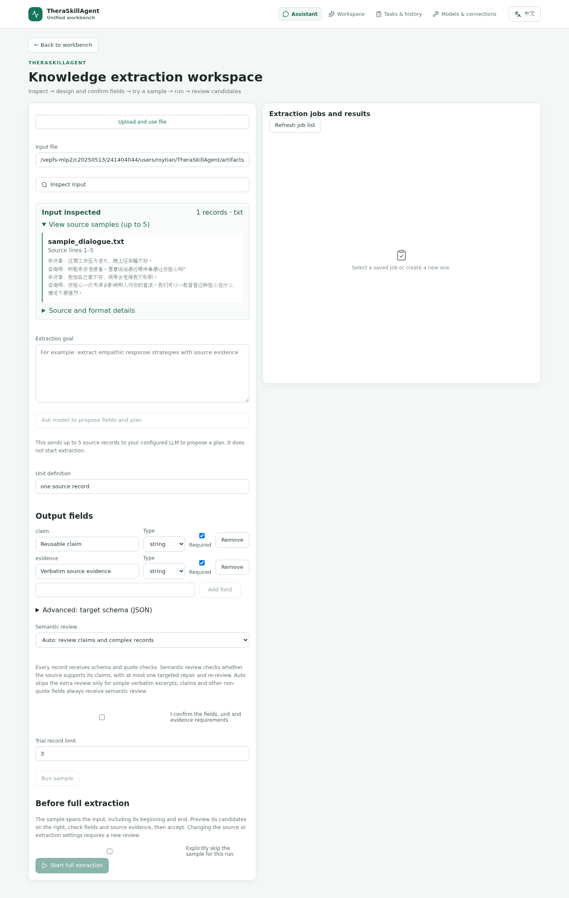

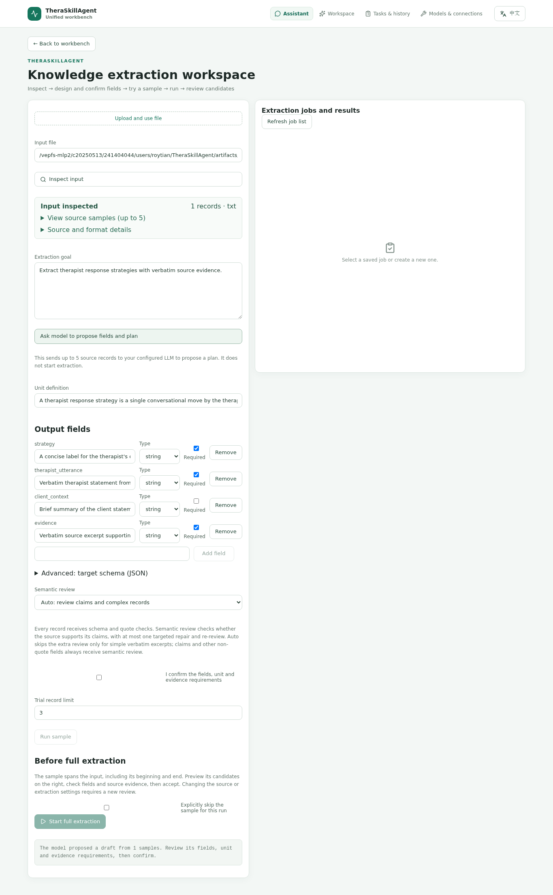

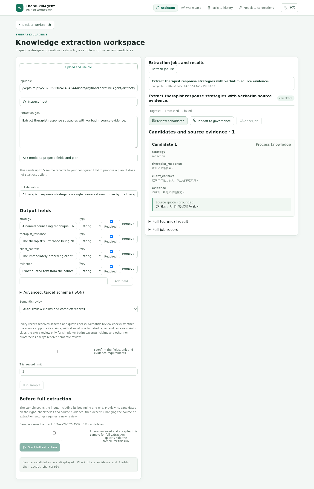

The real trial generated fields for strategy, therapist response, client context, and evidence. The evidence quote was shown as `grounded` because it matched the source text. A model output is still a candidate until governance review approves it.

## 9. Review and govern candidates

1. Open **Expert Studio** and select the appropriate local workspace role.
2. In **Knowledge contribution**, inspect the structured candidate and its source evidence.
3. Resolve duplicate, conflict, missing-evidence, and scope findings. Return a candidate when the source does not support the claim.
4. Approve only when an authorized reviewer has checked the evidence and allowed use. The resulting release can then be indexed.
5. Use **Response review** for therapist responses and **Feedback review** for user or learner feedback. Model review is an aid to supervision, not a clinical license or a formal human evaluation.

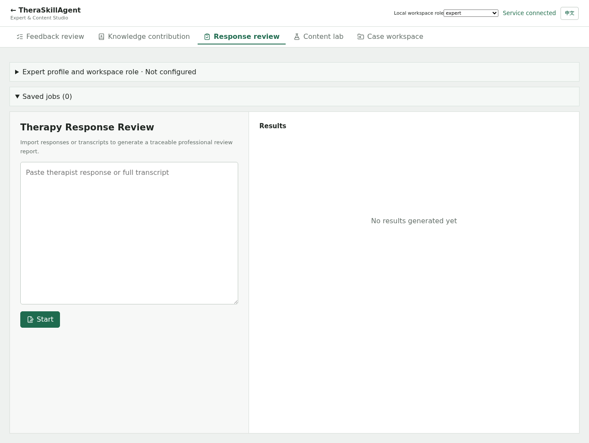

## 10. Build and use a simulated patient

1. Open **Training Studio**. Learners choose an approved scenario and click **Start training**. Instructors and researchers can switch roles and open the patient builder.
2. Define the training goal, difficulty, risk boundary, and disclosure expectations.
3. Generate online when you want a multi-stage draft. The workflow plans the case, writes a patient dossier, checks the scenario, and records the revision. You can also edit a dossier by hand.
4. Add recent events, timing, impact, hidden concerns, and disclosure levels. These details make the patient reusable across sessions without changing the old case revision.
5. Open **View and edit patient profile**, save a new revision, and review retrieved knowledge sources. A source entry can expand into its readable content and link back to the knowledge editor.
6. Start a role-play. Review the session and debrief afterwards. High-risk scenarios still require human supervision.

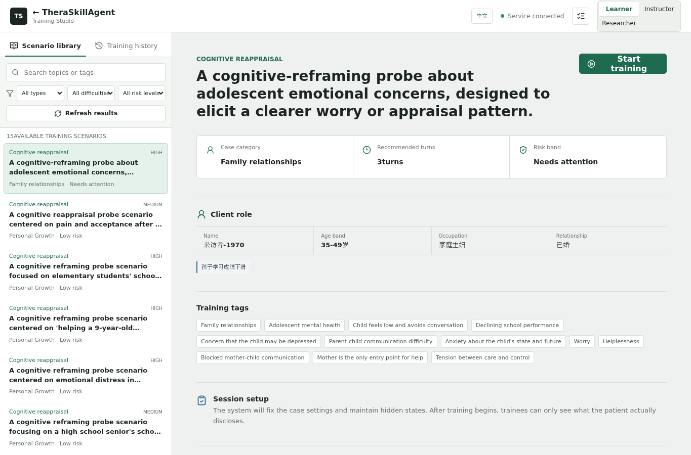

The scenario library distinguishes training type, difficulty, topic, and risk. Treat generated cases as drafts until a teacher checks the patient logic and repetition.

## 11. Design a course and review learning progress

1. Open **Courses and learning progress** and switch to the instructor view.
2. Ask the Course Agent to shape the audience, observable behavior, case difficulty, and practice order. Confirm the plan before assigning it.
3. Start from a course template or an approved scenario set. Add knowledge cards, short exercises, response anchors, and a debrief prompt.
4. Generate a batch only after checking coverage, risk, and duplicate warnings. Save the course version and assign it with a learner label.
5. In learner view, load the assigned progress, read the knowledge card, answer a short exercise, and request AI feedback. Then use the same goal in a full simulated session.
6. In instructor view, read the learner's original response, the model's evidence, and the rubric rationale. Record an independent observation and conclusion; keep it separate from the model score.

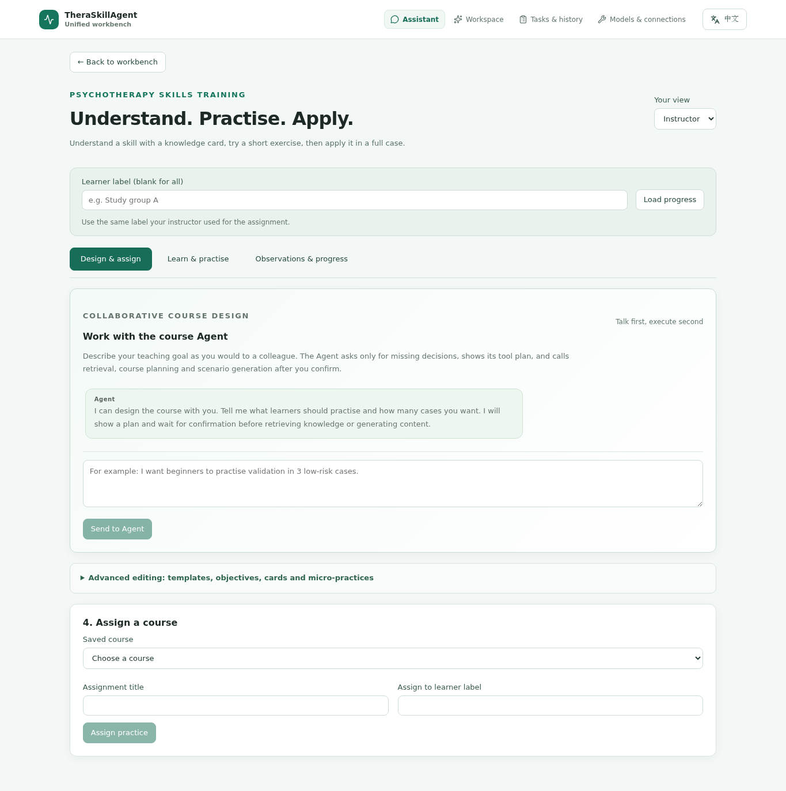

The course view is an agent-assisted planning surface. The teacher remains the person who selects cases, approves the course version, and interprets progress.

## 12. Use Skills and durable Tasks

1. Open **Automated tasks** when the job needs a plan, tools, a checkpoint, or a saved result.
2. Describe the result in one sentence and choose an installed Skill when appropriate. Attach a de-identified file or paste text.
3. The Agent may ask for speaker mapping, a schema decision, approval to write a resource, or a conflict resolution. Answer in **Progress & interaction** and resume the task.
4. **Tasks & history** lists active, waiting, completed, and archived executions. It is a run history, not the normal Assistant conversation list.

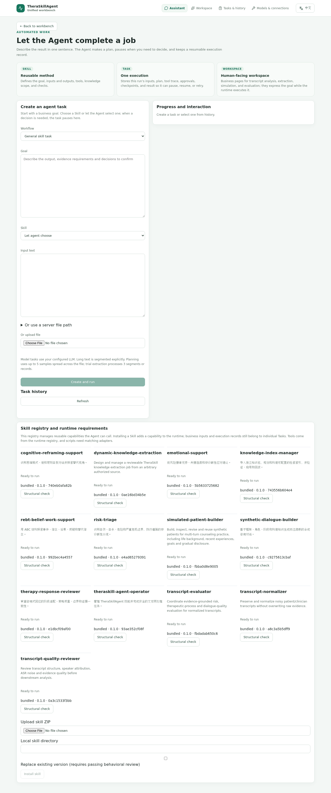

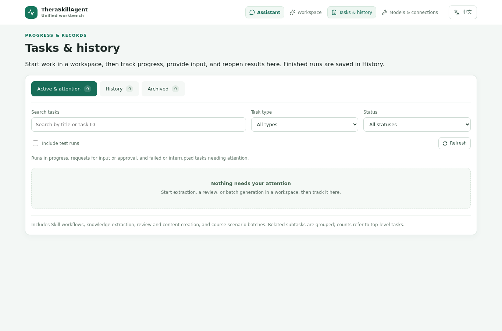

## 13. Check a change before release

1. Open **Pre-release behavior check**.
2. Establish a baseline with the same cases and rubric that will be used for the candidate.
3. Compare the actual outputs, citations, failures, and changes against the baseline. Add a human conclusion.
4. Do not activate a candidate when the baseline is missing or the comparison has not passed. A passing gate means that this case set did not show a configured regression; it is not evidence of clinical effectiveness.

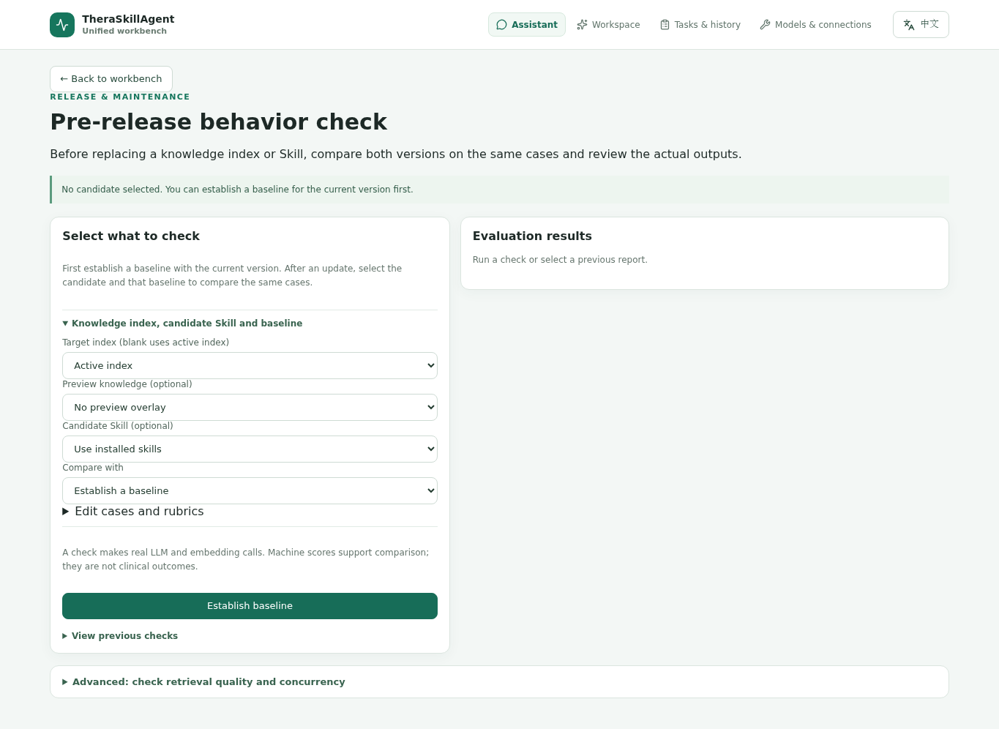

## 14. What the interface is protecting

- Source text is retained as the reference. Model corrections are suggestions until a person verifies them.
- Retrieval results are candidates. Open the source, allowed use, evidence tier, and language before using one.
- Extraction candidates are separate from released knowledge. Sample review and governance are required for a release.
- Patient profiles, scenarios, knowledge indexes, Skills, prompts, providers, and evaluation reports are versioned or referenced by the task record.
- Risk-sensitive training and response review require qualified human oversight. The system does not diagnose, certify competence, or replace supervision.

The English walkthrough was checked on the isolated project used for these screenshots. The model test, Assistant case, knowledge search, source inspection, extraction plan, trial extraction, and candidate preview all used the running application. The isolated run report remains local under `artifacts/full_e2e_20261027_wPV4ZR/` and is not part of the source distribution.
